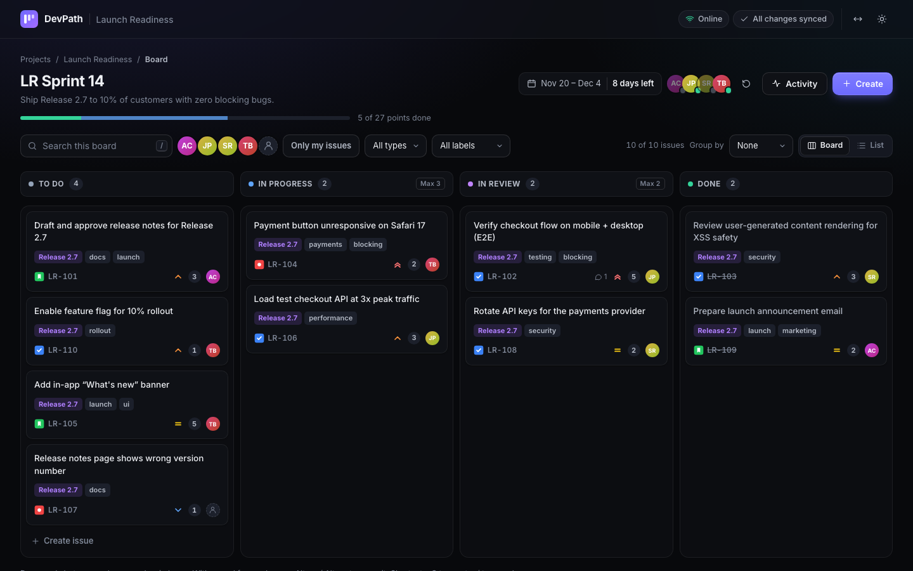
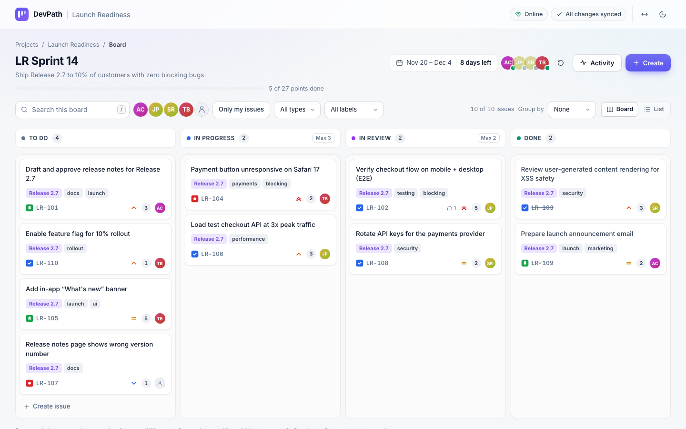
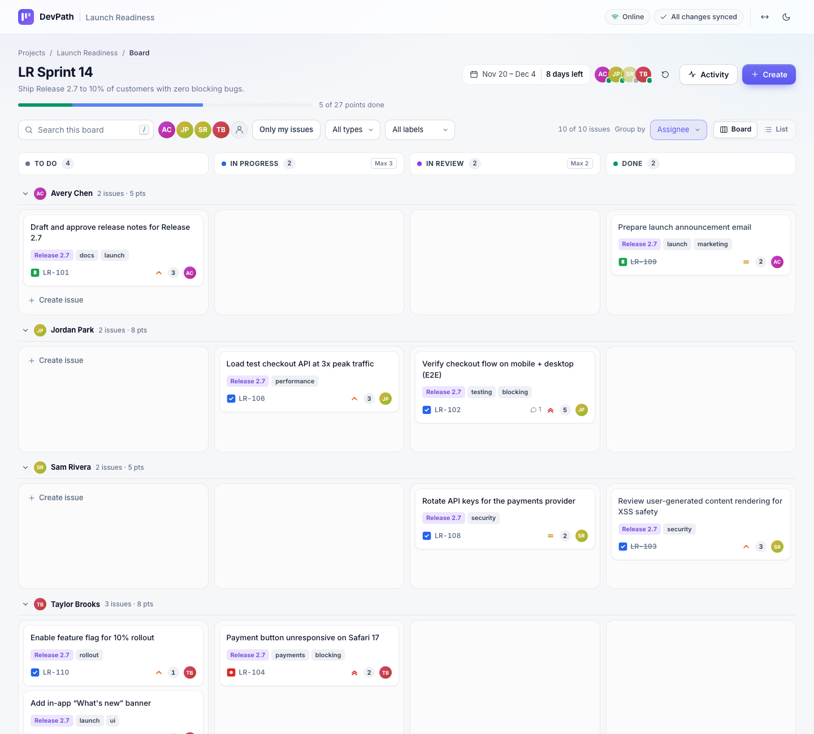
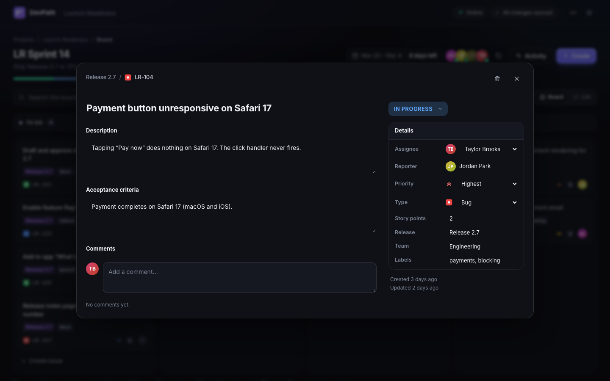
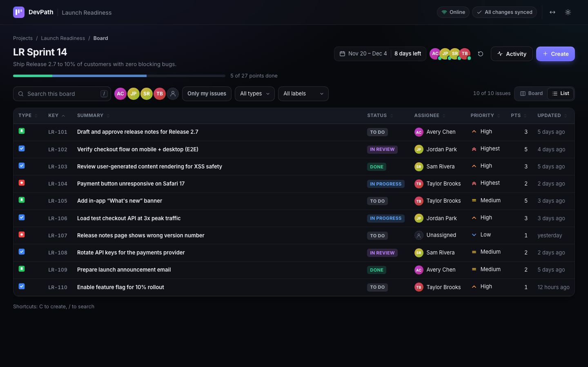

<div align="center">

# Launch Readiness Board

### Jira-style agile sprint board with offline-first sync and optimistic updates


<p>A Jira-style <b>Kanban and Scrum sprint board</b> built with <b>React 19, Vite 7 and TanStack Query 5</b>. It has drag-and-drop issues, swimlanes, WIP limits, optimistic updates with rollback, and an <b>offline-first sync queue</b>. Use it as an open-source project-management UI and as a reference for modern React architecture.</p>

[**Features**](#features) &nbsp;•&nbsp; [**Quick Start**](#quick-start) &nbsp;•&nbsp; [**Architecture**](#architecture-how-a-change-flows) &nbsp;•&nbsp; [**Tech Stack**](#libraries-and-tech-stack) &nbsp;•&nbsp; [**Structure**](#project-structure) &nbsp;•&nbsp; [**Testing**](#testing)



</div>

---

<details>
<summary><b>Table of contents</b></summary>

- [Introduction](#introduction)
- [Screenshots](#screenshots)
- [Features](#features)
- [Use cases](#use-cases)
- [Quick start](#quick-start)
- [Libraries and tech stack](#libraries-and-tech-stack)
- [Project structure](#project-structure)
- [Architecture: how a change flows](#architecture-how-a-change-flows)
- [Testing](#testing)
- [Accessibility](#accessibility)
- [FAQ](#faq)
- [Keywords](#keywords)

</details>

## Introduction

**Launch Readiness Board** is an issue tracker and agile sprint board for coordinating a product
launch across teams such as Product, QA, Security, Engineering and Marketing. It works the way people
expect from tools like Jira, Linear or Trello:

- issues with types, priorities, story points, assignees and comments
- a four-column workflow board with WIP limits
- swimlanes and quick filters
- a sortable list view

Its focus is **reliability on unreliable networks**:

- Every change appears **immediately**, using optimistic UI.
- When the server rejects a change, the change **rolls back** and a toast explains what happened.
- While you're offline, changes go into a **persistent queue**. They replay in order, with
  exponential backoff, once you reconnect.

The project is **frontend-only**. An in-browser mock API simulates network latency and random
failures, so you can try every edge case without setting up a backend. To use real data, swap
`src/server/tasks.server.js` for HTTP calls. Nothing else needs to change.

> This is an independent project. It is not affiliated with or endorsed by Atlassian. "Jira-style"
> only describes the workflow.

---

## Screenshots

### Sprint board (dark theme)

The sprint header shows the goal, the dates, the days left and a story-points progress bar. Each
column shows its issue count, and In Progress and In Review show their WIP limits.


### Sprint board (light theme)



### Swimlanes grouped by assignee

Group the board by assignee, priority or release. Dropping a card into another lane updates that
field.



### Issue detail dialog

Every field can be edited in place. The dialog includes status, assignee, priority, type, story
points, release, team, labels, description, acceptance criteria and comments.



### Sortable list view



---

## Features

### Issue tracking
- **Issue types:** Story, Task and Bug, each with its own icon.
- **Priorities:** Highest, High, Medium and Low, shown as colored arrows.
- **Issue fields:** assignee, reporter, story points, release, team, labels, description, acceptance criteria and comments.
- **Sequential keys** such as `LR-101` and `LR-102`.
- **Deep links:** `/board?issue=LR-104` opens that issue directly. The link can be shared and survives a reload.

### Board and workflow
- **Four columns:** To Do → In Progress → In Review → Done.
- **WIP limits:** a column header turns red when the column has too many issues.
- **Drag and drop** between columns. From the keyboard, focus a card and press **Alt+← / Alt+→**.
- **Swimlanes:** group by assignee, priority or release. Lanes can be collapsed and show their story-point totals.
- **Inline create:** use "+ Create issue" at the bottom of any column. A full **Create issue** dialog is also available.
- **Quick filters:** text search, assignee avatars (including Unassigned), "Only my issues", type and label.
- **Board / List switch.** The list view is a sortable table.
- **Keyboard shortcuts:** `C` creates an issue and `/` focuses search.

### Reliability and UX
- **Optimistic updates with automatic rollback.** Summary edits fail 20% of the time on purpose, so you can watch the rollback.
- **Offline-first sync queue.** It's stored in `localStorage`, pending issues are marked, and the queue replays in order with exponential backoff (1 s → 30 s).
- **Live sync status:** chips show Online / Offline and Syncing / Synced.
- **Team activity drawer:** shows team presence and an infinite-scroll activity feed. It is code-split and lazy-loaded.
- **Theme:** dark and light, following the system until you pick one, with no flash of the wrong theme on load.
- **Direction:** LTR and RTL layouts.
- **Persistence:** data survives reloads. The ↺ button resets the demo data.

---

## Use cases

| Who | How they use it |
|---|---|
| **Product and release managers** | Track everything that has to be done before a launch (release notes, feature flags, QA sign-off, security review) in one sprint. |
| **Engineering teams** | Run a lightweight Scrum or Kanban workflow with WIP limits, story points and swimlanes per developer. |
| **QA teams** | File bugs with acceptance criteria, then move them through In Review to Done. |
| **Teams with poor connectivity** | Keep working on flights, trains or flaky Wi-Fi. Changes sync when you're back online. |
| **React developers and students** | A real-world example of feature-sliced architecture, TanStack Query optimistic mutations, offline queues and accessible drag and drop. |
| **Interview and portfolio projects** | A complete, tested project that's quick to set up and shows state management, testing and UI craft. |
| **Starter template** | Fork it and replace the mock server with your REST or GraphQL API to get a production sprint board. |

---

## Quick start

**Requirements:** Node.js 20 or newer, and npm.

```bash
git clone https://github.com/Mian-Basam/launch-readiness-board.git
cd launch-readiness-board
./start.sh
```

Then open **http://localhost:5173/board**.

`start.sh` checks your Node version, installs dependencies when they're missing or out of date, and
won't start if the port is already in use.

| Command | What it does |
|---|---|
| `./start.sh` | Dev server with hot reload |
| `./start.sh prod` | Production build, then serve it |
| `./start.sh check` | Lint, tests and build |
| `PORT=3000 ./start.sh` | Use a different port |

<details>
<summary>Prefer plain npm scripts?</summary>

| Script | What it does |
|---|---|
| `npm install` | Install dependencies |
| `npm run dev` | Start the Vite dev server |
| `npm run build` | Production build to `dist/` |
| `npm run preview` | Serve the production build |
| `npm run lint` | ESLint |
| `npm test` | Run the Vitest suite once |
| `npm run test:watch` | Vitest in watch mode |

</details>

### Try offline mode

1. Open DevTools → **Network** and set throttling to **Offline**.
2. Move a card, edit a field or add a comment. The issue shows a **Pending sync** marker and the header shows the queue count.
3. Set throttling back to **No throttling**. The queue replays and the status shows **All changes synced**.

---

## Libraries and tech stack

The app has only **four runtime dependencies**. Everything else (icons, drag and drop, modals,
toasts, the design system) is written from scratch.

### Runtime

| Library | Version | Why it's used |
|---|---|---|
| [**React**](https://react.dev) | 19.2 | UI rendering. Uses `useDeferredValue` (keeps typing in search fast), `useId` (accessible labels), `React.lazy` + `Suspense` (code-split activity panel) and error boundaries. |
| [**React DOM**](https://react.dev/reference/react-dom) | 19.2 | Browser renderer. |
| [**TanStack Query**](https://tanstack.com/query) | 5.90 | Server-state cache. Handles queries, **optimistic mutations** (`onMutate` → rollback in `onError` → `invalidateQueries`), the **infinite query** that pages the activity feed, and pausing queries while offline. |
| [**React Router**](https://reactrouter.com) | 7.13 | Routing (`/` → `/board`, 404 page) and `useSearchParams` for the `?issue=` deep link. |

### Development and tooling

| Library | Version | Why it's used |
|---|---|---|
| [**Vite**](https://vite.dev) + `@vitejs/plugin-react` | 7.3 | Dev server with hot module replacement and the production bundler. The bundle is about 100 kB gzipped. |
| [**Vitest**](https://vitest.dev) | 4.1 | Unit and integration test runner, configured in `vite.config.js`. |
| [**Testing Library**](https://testing-library.com) (`react`, `user-event`, `jest-dom`) | 16.3 / 14.6 / 6.9 | Tests the app the way a user would: by role, label and keyboard. |
| [**jsdom**](https://github.com/jsdom/jsdom) | 29.1 | Browser environment for the tests. |
| [**ESLint**](https://eslint.org) + `react-hooks` v7 + `react-refresh` | 9.39 | Linting, including the React Compiler-aware hooks rules. |

### Styling

- **Plain CSS with design tokens** (`src/shared/styles/tokens.css`). The tokens are CSS custom properties for surfaces, text, status colors, issue types, priorities, radii and shadows, with a full light-theme override.
- The **Inter** font from Google Fonts.
- No CSS framework, so there's no runtime styling cost.

---

## Project structure

<details>
<summary><b>Show the full project structure</b></summary>

The code is **feature-sliced**: each feature owns its components, hooks, selectors and services.
Shared building blocks live in `shared/`.

```
launch-readiness-board/
├─ start.sh                    One-command launcher (dev / prod / check)
├─ index.html                  Pre-paint theme script, font loading
├─ vite.config.js              Vite + Vitest config
├─ docs/screenshots/           README images
├─ public/favicon.svg
└─ src/
   ├─ main.jsx / App.jsx       Entry point and root component
   ├─ app/
   │  ├─ providers/            Query, Theme, I18n, Toast and Sync providers
   │  │                        (contexts.js + hooks.js keep Fast Refresh happy)
   │  ├─ router/routes.jsx     "/" → "/board", 404
   │  └─ shell/AppShell.jsx    Top bar: logo, sync status, theme and direction controls
   ├─ features/
   │  ├─ board/                BoardPage (composes the screen), BoardHeader (sprint header)
   │  ├─ tasks/
   │  │  ├─ components/        IssueCard, TaskBoard (columns + swimlanes), InlineCreate,
   │  │  │                     TaskList, TaskFilters, TaskDetails, TaskComposer, IssueIcons
   │  │  ├─ hooks/useTasks.js  useTasksQuery, useSprintQuery, useTaskActions
   │  │  ├─ selectors/         Pure functions: filter, group, lanes, sort, offline overlay
   │  │  └─ services/          API wrappers + offline job runner
   │  ├─ activity/             Activity feed (infinite query, lazy-loaded)
   │  ├─ presence/             Presence avatars + "who's online" list
   │  └─ settings/             Theme / direction controls, sync status chips
   ├─ server/tasks.server.js   Mock API: latency, random failures, activity log
   ├─ mocks/                   Seed DB (persisted to localStorage), people, fake websocket
   ├─ shared/
   │  ├─ ui/                   Icon, Avatar, Button, Input, Overlay (modal/drawer), ErrorBoundary
   │  ├─ lib/                  offlineQueue, storage, visual helpers
   │  └─ styles/               tokens.css, globals.css
   └─ test/setup.js            jest-dom matchers
```

### Key modules

| Module | Responsibility |
|---|---|
| `tasksSelectors.js` | All board logic as **pure, tested functions**: `filterTasks`, `groupByStatus`, `groupIntoLanes`, `sortTasks`, `applyJob`, `applyPendingJobs`. |
| `useTasks.js` | One `useTaskActions()` hook that exposes `create`, `update`, `move`, `comment` and `remove`. Each one updates optimistically when online and queues when offline. |
| `SyncProvider.jsx` | Tracks online status, keeps the offline queue, and replays it with backoff. |
| `offlineQueue.js` | Saves the queue to `localStorage`. `flushQueue` stops at the first failure so the order is kept. |
| `Overlay.jsx` | Accessible modal and drawer: `role="dialog"`, focus moves in, Escape and backdrop close it, and focus returns afterwards. |
| `tasks.server.js` | Mock backend with a field whitelist, validation, no-op detection and human-readable activity entries. |

</details>

---

## Architecture: how a change flows

```
 UI action ──► useTaskActions().update(id, patch)
                   │
        online? ───┼──────────────────────────────┐
           yes     │                              │ no
                   ▼                              ▼
   onMutate: applyJob() to the cache    SyncProvider.enqueue(job)
   (UI updates instantly)               → saved to localStorage
                   │                    → BoardPage shows server data
                   ▼                      + applyPendingJobs(queue)
        API call (mock server)            ("Pending sync" marker)
          │               │                       │
       success          error                     ▼ back online
          │               │              flushQueue() replays in order,
          ▼               ▼              exponential backoff on failure
  invalidate tasks   roll back cache                │
  + activity         + error toast                  ▼
                                          invalidate → fresh server data
```

---

## Testing

```bash
npm test          # or: ./start.sh check
```

There are **45 tests** across 5 files:

| Test file | What it covers |
|---|---|
| `tasksSelectors.test.js` | Filtering, grouping, swimlanes, sorting and applying offline jobs on top of server data. |
| `offlineQueue.test.js` | Saving the queue, ordered replay and stopping at the first failure. |
| `tasks.server.test.js` | Mock API validation, whitelisting and activity log text. |
| `i18n.test.js` | Translation lookup and `{variable}` interpolation. |
| `BoardPage.test.jsx` | Full-app integration tests: load the board, move with the keyboard, create inline and from the dialog, edit and comment, open a deep link, delete, quick filters, swimlanes, list sorting, offline queue → sync, and the `C` shortcut. |

---

## Accessibility

- Every column is a labelled `region`, and every card is a `button` with `aria-pressed`.
- **Keyboard drag and drop:** Alt+Arrow moves cards, and the direction follows RTL.
- Dialogs move focus inside when they open, close with Escape and return focus to the element that opened them.
- Sortable table headers use `aria-sort`.
- Form fields have visible labels. Search has a screen-reader label.
- Status is never shown by color alone. It always has a text lozenge or label too.

---

## FAQ

**Does it need a backend?**
No. The mock server runs in the browser and saves to `localStorage`. To use a real API, replace the
functions in `src/server/tasks.server.js` with `fetch` calls that return the same shapes.

**How do I reset the data?**
Click the ↺ button in the sprint header, or clear the site's `localStorage`.

**Why do some summary edits fail?**
On purpose. The mock server rejects 20% of summary edits so you can see the optimistic rollback and
the error toast.

**Can I reorder cards within a column?**
Not yet. Cards are sorted by priority, then by key.

**Can I create issues while offline?**
No, because the server assigns issue keys. Edits, moves, comments and deletes all work offline.

---

## Keywords

React 19 Kanban board · Jira-style sprint board · agile project management app · Scrum board React ·
TanStack Query optimistic updates · React Query offline sync · offline-first React app · drag and drop
Kanban · swimlanes · WIP limits · issue tracker React · Vite 7 React template · Vitest Testing Library
example · feature-sliced architecture · accessible drag and drop · dark mode React app

---

<div align="center">

**Built by [Mian Basam Ahmad](https://github.com/Mian-Basam)** · Software Engineer & Tech Lead

[](https://mian-basam.github.io) [](https://www.linkedin.com/in/mian-basam-ahmad-68b997147/) [](https://github.com/Mian-Basam)

<sub>If this project helped you, consider giving it a ⭐</sub>

</div>
